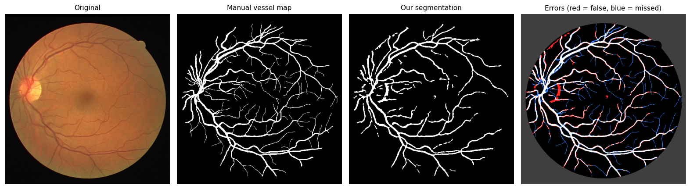
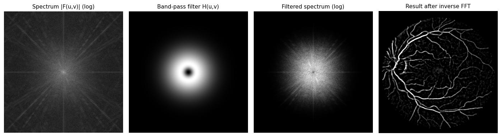
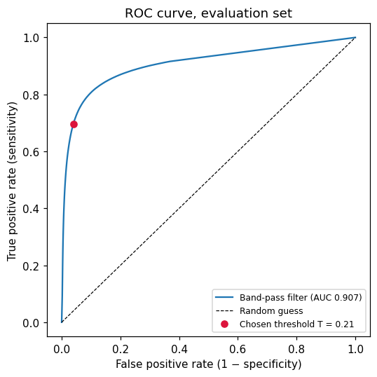

# Retinal Blood Vessel Segmentation (Frequency Domain Band-Pass Filtering)

[](https://colab.research.google.com/github/dhay01/Retinal-Blood-Vessel-Segmentation/blob/main/notebooks/retinal_vessel_segmentation_bandpass.ipynb)

Segmenting blood vessels in retina photos from the DRIVE dataset, using classic image processing: a **Gaussian band-pass filter in the frequency domain**. No deep learning.



*Left to right: original photo, expert's manual vessel map, our segmentation, error map (white = correct, red = false vessel, blue = missed vessel).*

## Dataset

[DRIVE](https://drive.grand-challenge.org/) (Digital Retinal Images for Vessel Extraction) has 40 colour retina photos. Each comes with an expert's manual vessel map and a mask of the round retina area (FOV).

- **Tuning set** (images 21–40): used to choose the filter settings and the threshold.
- **Evaluation set** (images 1–20): used once at the end to measure the final result.

The dataset is **not included** in this repository. The notebook downloads it automatically in its first cell.

## Method

1. **Green channel**: vessels have the best contrast here.
2. **Image negative**: vessels become bright instead of dark.
3. **CLAHE** (adaptive histogram equalization): evens out contrast across the image.
4. **3×3 median filter**: removes noisy pixels.
5. **Gaussian band-pass filter (FFT)**: removes uneven lighting (very low frequencies) and noise (very high frequencies) and keeps the vessels (middle frequencies).
6. **Thresholding**: the threshold is chosen on the tuning set to give the best Dice score.
7. **Speck removal**: blobs smaller than 30 pixels are deleted.



## Results

Chosen settings (on the tuning set): `D_low = 20`, `D_high = 80`, threshold `T = 0.21`.

Results on the 20 evaluation images (mean ± standard deviation, pixels inside the FOV only):

| Dice | Sensitivity | Specificity | Accuracy | AUC |
|:---:|:---:|:---:|:---:|:---:|
| 0.711 ± 0.029 | 0.678 ± 0.051 | 0.968 ± 0.009 | 0.930 ± 0.007 | 0.908 ± 0.019 |

For comparison, Yue (2023) reported AUC = 0.75 on one DRIVE image, and Staal et al. (2004) reported AUC = 0.952.

<p align="center">
  
</p>

More figures are in the [`results/`](results/) folder.

## How to run

```bash
pip install -r requirements.txt
jupyter notebook notebooks/retinal_vessel_segmentation_bandpass.ipynb
```

Run the cells from top to bottom. The first cell downloads DRIVE, and all figures are saved to a `figures/` folder. The notebook also runs in Google Colab.

## Project structure

```
├── notebooks/
│   └── retinal_vessel_segmentation_bandpass.ipynb   # full pipeline with explanations
├── results/                                         # figures produced by the notebook
├── requirements.txt
└── README.md
```

## What I learned

- In this task, CLAHE worked clearly better than plain histogram equalization (Dice 0.71 vs 0.68).
- Smooth (Gaussian) filters avoid the ringing artefacts that sharp "ideal" filters create.
- Settings have to be chosen on separate images from the ones used for evaluation. Otherwise the results look better than they really are.
- Accuracy alone is misleading here because about 88% of the pixels are background, so Dice and sensitivity matter more.

## Future work

- Detect more of the thin vessels (sensitivity is the weakest number).
- Reduce false vessels around the optic disc.
- Compare with a deep learning model such as U-Net.

## References

- Staal, J. et al. (2004). Ridge-based vessel segmentation in color images of the retina. *IEEE Transactions on Medical Imaging*.
- Yue (2023).
